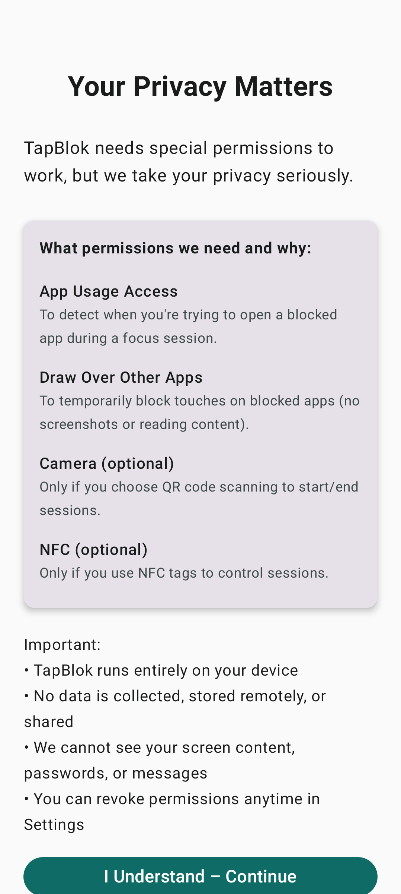
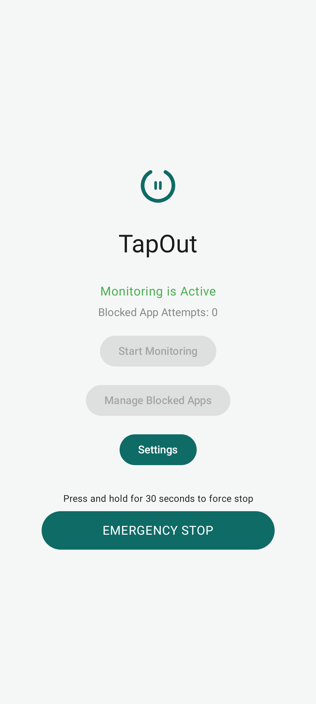
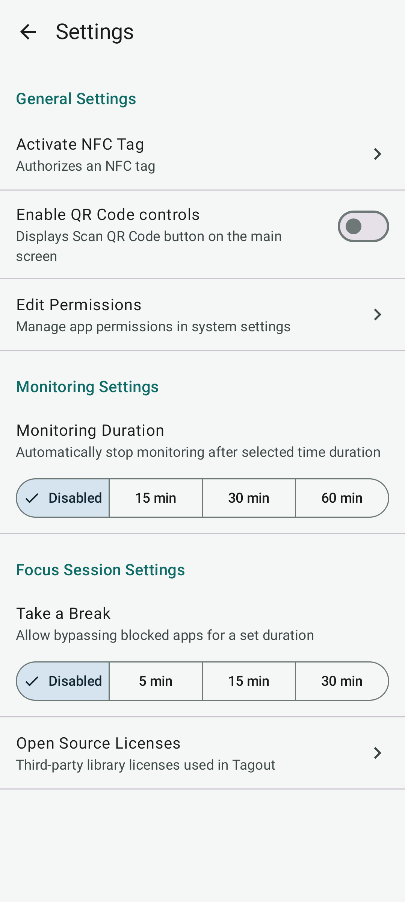
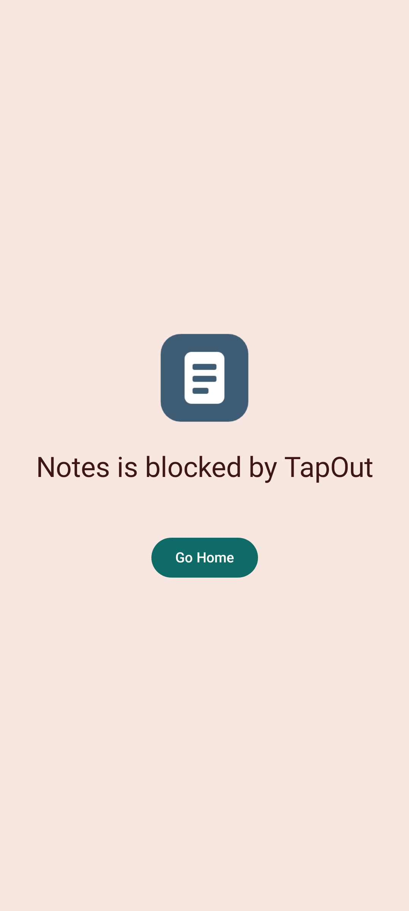

# TapOut

TapOut is an Android focus app. A session stays on until you scan an NFC tag or a QR code you created, so stopping it takes a deliberate step away from the phone.

This repository is a fork of [TapBlok by cajdata](https://github.com/cajdata/TapBlok), which is licensed under Apache 2.0. The original copyright and license stay in place. Galynte maintains this fork under the name TapOut, including the extra session controls and the launcher artwork. This fork is not endorsed by the original author. Details are in [NOTICE](NOTICE).

The app is Kotlin, with Jetpack Compose for the UI, Room for on-device storage, and coroutines for the monitoring loop.

## Get the app

<a href="https://play.google.com/store/apps/details?id=com.galynte.tapblok"></a>
<a href="https://github.com/Galynte/TapBlok/releases"></a>

## Screenshots

| Privacy notice | Home |
| :------------: | :--: |
|  |  |

| Settings | Blocked app |
| :------: | :---------: |
|  |  |

## What it does

* **App selection.** Choose any launchable app to block. Dialer, SMS, Settings, and launchers stay off the list so the phone cannot be locked out of essentials.
* **Select all / clear all.** The app list can be filled or emptied in one step.
* **Session control.** Start or stop a session from the home screen, an NFC tag (including common NTAG215 tags), a QR code, or the "Start Session" shortcut on the app icon.
* **Automatic timeout.** Settings can end a session after 15, 30, or 60 minutes without a scan or the emergency hold.
* **Emergency override.** During a session, holding the stop control for 30 seconds ends it if the tag or QR code is missing.
* **Blocking screen.** Opening a blocked app shows a cover screen. Back goes home, which closes a common bypass.
* **Breaks.** When breaks are enabled, a session includes three breaks (5, 15, or 30 minutes). The counter resets when the next session starts.
* **Attempt counter.** The home screen counts how many times a blocked app was opened during the current session.

## How it works

* **Permissions**
  * `PACKAGE_USAGE_STATS` — which app is in the foreground, by package name only.
  * `SYSTEM_ALERT_WINDOW` — the blocking screen over a restricted app.
  * `CAMERA` — optional, and only for scanning a TapOut QR code.
  * `NFC` — optional, and only for reading or writing a session tag.
* **UI.** `MainActivity` is the home screen. `AppSelectionActivity` is the block list. `SettingsActivity` holds session options. `PrivacyExplanationActivity` runs once, before the home screen.
* **Storage.** Room stores `BlockedApp` rows (package name only). `BlockedAppDao` inserts, deletes, and lists them.
* **Monitoring.** `AppMonitoringService` is a sticky foreground service. About once a second it compares the foreground package with the block list and, on a match, opens `BlockingActivity`.
* **NFC and QR.** `NfcWriteActivity` writes a custom MIME type to a tag. `NfcHandlerActivity` reads that tag and toggles monitoring. `QrCodeActivity` shows the code the home screen scans.

## Privacy

TapOut stores its data on the device and does not send it to a server. The full policy is in [PRIVACY.md](PRIVACY.md).

## Build and publish

Debug build:

```bash
./gradlew assembleDebug
```

Release bundles for Google Play, including native debug symbols, are described in [PUBLISHING.md](PUBLISHING.md). Tagged releases are built by the GitHub Actions workflow.

## License

Apache License 2.0. See [LICENSE](LICENSE).

The original TapBlok project by cajdata is also Apache 2.0. Attribution for that work, and for the original artwork in this fork, is in [NOTICE](NOTICE).

Product names and trademarks belong to their respective owners.
